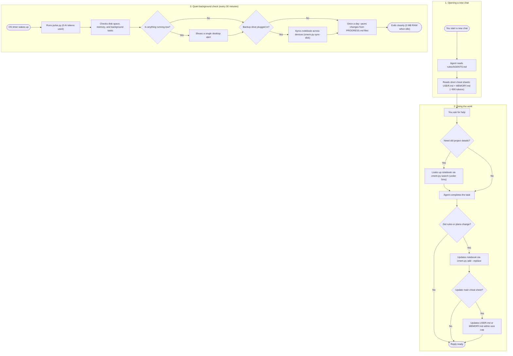

# agy-cortex

Give your Antigravity agent a long-term memory and quiet system checks, without installing third-party apps.

---

Open a new chat with an AI agent and it acts like you have never met. Yesterday you spent twenty minutes explaining your project layout, fixing a tricky bug, and agreeing on how tests should run. Today you start from zero, pasting massive status notes into the chat box so the agent catches up.

Tools like **Hermes Agent** and **OpenClaw** solve parts of this problem, yet many people cannot run them alongside Antigravity. Work laptops often block third-party agent software and external bots. Even when allowed, running separate Node.js or Docker daemons eats RAM all day and risks burning AI tokens in the background.

`agy-cortex` gives you those capabilities inside Antigravity itself using native plugin rules and lightweight Python scripts.

## Built from scratch, inspired by proven ideas

`agy-cortex` is not a fork of Hermes Agent or OpenClaw, and it never runs external software or background bots. Instead, it takes their core architectural patterns (*Observe, Adapt, Modify*) and rebuilds them cleanly with Python's built-in tools:

| Pattern adapted | Module in `agy-cortex` | What you get |
| :--- | :--- | :--- |
| **Short profile snapshots + fast lookup** (Hermes style) | `cortex-memory` (`scripts/cmem.py`) | A compact two-page cheat sheet loaded at startup, plus a searchable local notebook that recalls old decisions in under 5 milliseconds. |
| **Scheduled health checks** (OpenClaw style) | `cortex-pulse` (`scripts/pulse.py`) | A timer that checks disk space, free memory, and backups every 30 minutes using 0 MB RAM when idle and 0 AI tokens. |

Everything runs under your normal Antigravity workspace rules. No external gateway, no always-on server, and no background API bills.

## How your agent uses it

Think of `agy-cortex` as giving your assistant two everyday habits: glance at a short cheat sheet before starting work, and write down important decisions in a local notebook instead of cramming every chat into short-term memory.



Each phase handles one clear job:

| Phase | When it runs | What happens | Cost |
| :--- | :--- | :--- | :--- |
| **Opening a chat** | Every new conversation | Loads your short `USER.md` and `MEMORY.md` cheat sheets | ~900 tokens total |
| **Looking things up** | Only when past context matters | Searches local `memory.db` and pulls only matching lines | Under 5 ms locally |
| **Background check** | Every 30 minutes via OS timer | Checks computer health, indexes updated notes, and syncs backup drives | 0 MB idle, 0 AI tokens |

## What it costs your computer and AI quota

A memory layer should never slow down your laptop or fill half the chat window before you type a word.

### On your computer

Many background assistants stay open in memory all day. `agy-cortex` runs only when triggered and exits immediately afterward.

| Action | How it runs | Peak RAM | Time taken | AI tokens |
| :--- | :--- | :--- | :--- | :--- |
| **Waiting between runs** | No background daemon | 0 MB | 0 ms | 0 tokens |
| **Searching old notes (`cmem.py search`)** | Local SQLite FTS5 query | Under 18 MB | Under 5 ms | 0 tokens |
| **Saving or replacing a rule (`cmem.py add`)** | Single database write | Under 16 MB | Under 10 ms | 0 tokens |
| **Health check (`pulse.py`)** | Quick Python check | Under 25 MB | 15 to 35 ms | 0 tokens |
| **Syncing to a backup drive (`cmem.py sync-disk`)** | File merge and check | Under 22 MB | 80 to 200 ms | 0 tokens |

### Inside the AI's head

Pasting massive chat logs or long `PROGRESS.md` files into every new session makes replies slower, wastes your quota, and confuses the model when old notes contradict new rules. `agy-cortex` gives the AI a short two-page reference sheet instead of a 100-page binder.

| What gets measured | Pasting full history | Using `agy-cortex` | Why it helps |
| :--- | :--- | :--- | :--- |
| **Startup context size** | 10,000 to 45,000+ tokens | ~800 to 1,000 tokens fixed | Over 90% smaller starting prompt |
| **User profile cap (`USER.md`)** | Grows without limit | Max 1,500 characters (~350 tokens) | Keeps preferences concise |
| **Machine notes cap (`MEMORY.md`)** | Piles up stale logs | Max 2,500 characters (~600 tokens) | Keeps system info current |
| **Prompt cache reuse** | Low (text shifts constantly) | High (> 95% prefix cache hit) | Static cheat sheets stay cached across turns |
| **Looking up old decisions** | Reads everything every turn | ~150 to 300 tokens per lookup | Pulls only the exact note needed |
| **Conflicting rules** | Common (old notes stay behind) | Zero (`--replace` overwrites old rules) | Old decisions get replaced cleanly |

## Setup in 5 minutes

You do not need external databases, Docker, or Node.js. All you need is Python 3.10 or newer (pre-installed on most Mac and Linux machines, and quick to install on Windows).

### 1. Copy the plugins and scripts

**On Windows (PowerShell):**
```powershell
New-Item -ItemType Directory -Path "$HOME\.gemini\config\plugins", "$HOME\.gemini\config\memory" -Force
Copy-Item -Path "plugins\*" -Destination "$HOME\.gemini\config\plugins\" -Recurse -Force
Copy-Item -Path "scripts\cmem.py", "scripts\pulse.py" -Destination "$HOME\.gemini\config\memory\" -Force
```

**On Mac or Linux (Terminal):**
```bash
mkdir -p ~/.gemini/config/plugins ~/.gemini/config/memory
cp -r plugins/* ~/.gemini/config/plugins/
cp scripts/cmem.py scripts/pulse.py ~/.gemini/config/memory/
chmod +x ~/.gemini/config/memory/cmem.py ~/.gemini/config/memory/pulse.py
```

### 2. Create your personal cheat sheets

Copy the example templates into your config folder:

```bash
cp templates/USER.example.md ~/.gemini/config/memory/USER.md
cp templates/MEMORY.example.md ~/.gemini/config/memory/MEMORY.md
cp templates/PULSE.example.md ~/.gemini/config/memory/PULSE.md
```

Open `USER.md` and `MEMORY.md` in any text editor and add your own details (such as timezone, preferred tone, or where you keep project folders). Then initialize your local database:

```bash
python ~/.gemini/config/memory/cmem.py init
```

This creates `memory.db` and wires your cheat sheets into Antigravity's plugin rules so every new chat starts with your context.

### 3. Turn on the 30-minute health check (optional)

If you want automatic warnings for low disk space or low RAM, plus background backup syncing:
- **Windows:** Open Task Scheduler and create a task named `CortexPulse` that runs `python %USERPROFILE%\.gemini\config\memory\pulse.py` every 30 minutes.
- **Linux:** Set up a `systemd --user` timer (`agy-pulse.timer`) that runs `python3 ~/.gemini/config/memory/pulse.py` every 30 minutes.

### 4. Try it yourself

Run these commands directly, or let your Antigravity agent run them for you:

```bash
# Search saved project notes
python ~/.gemini/config/memory/cmem.py search "database migration"

# Save a new decision (or overwrite an old one with the same title)
python ~/.gemini/config/memory/cmem.py add --project "my-app" --category "decision" --title "Login timeout" --content "Set session timeout to 15 minutes." --replace

# Print a live health check report
python ~/.gemini/config/memory/pulse.py --report
```

## Optional settings

Change thresholds or folder paths with environment variables without editing any Python files:

| Variable | What it controls | Default |
| :--- | :--- | :--- |
| `CORTEX_MEM_DIR` | Folder storing `memory.db`, `USER.md`, and `MEMORY.md` | `~/.gemini/config/memory` |
| `CORTEX_ACTIVE_HOURS` | Hours when desktop notifications can appear (`start-end`) | `7-22` |
| `CORTEX_DISK_WARN_PCT` | Disk fullness percentage that triggers an alert | `90` |
| `CORTEX_RAM_AVAIL_MIN_MB` | Minimum free RAM in MB before alerting | `400` |
| `CORTEX_PROGRESS_ROOTS` | Project folders scanned daily for `PROGRESS.md` files | `~/Projects`, `~/Documents/Projects` |
| `CORTEX_DISK_MEM_DIR` | Explicit folder path on a portable backup drive | Auto-detected |

## Your data stays local

Personal notes (`USER.md`, `MEMORY.md`), checklists (`PULSE.md`), local databases (`memory.db`), API keys, and alert logs are ignored by `.gitignore`. Nothing personal leaves your machine. Only the shared plugin rules, scripts, and blank templates belong in this repository.

## License

MIT
