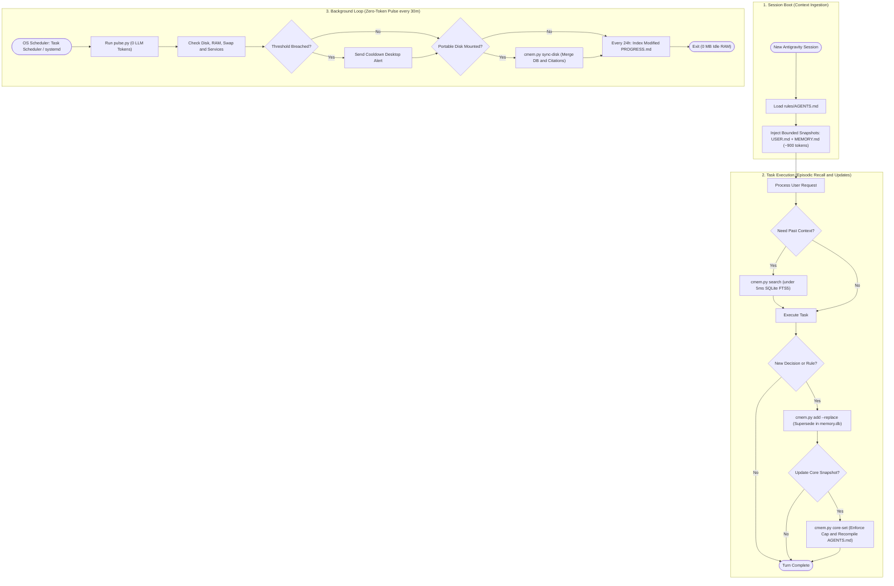

# agy-cortex

Persistent memory engine and zero-token proactive monitor for Antigravity agents.

## Overview

`agy-cortex` gives Antigravity agents long-term episodic memory, bounded context snapshots, and scheduled local health checks. It runs strictly on standard Python libraries and native Antigravity plugin rules with zero idle RAM usage and zero background LLM token consumption.

## Motivation and Design Philosophy

### The Problem
Many Antigravity users face two recurring limitations when working on multi-session projects:
1. **Context Loss Across Sessions:** Without persistent storage, agents forget prior architectural decisions, resolved bugs, and workflow conventions as soon as a conversation ends. Manually pasting long `PROGRESS.md` files into every new session wastes token budget and degrades prompt focus.
2. **Third-Party Application Restrictions:** External agent ecosystems such as **Hermes Agent** and **OpenClaw** address memory and proactive daemon execution, but many users are restricted from installing or running third-party agent applications, external gateways, or heavy Node.js/Docker background daemons alongside Antigravity due to workplace policies, restricted environments, or tight hardware limits.

### Architectural Approach (Not a Fork)
`agy-cortex` is **not a fork** of Hermes Agent or OpenClaw, and it does not depend on or execute any third-party application binaries. Instead, it applies their proven architectural concepts through clean native reimplementation (*Observe, Adapt, Modify*):

| External Architectural Inspiration | Native Implementation in `agy-cortex` | Key Mechanism |
| :--- | :--- | :--- |
| **Hermes-style Bounded Memory & Recall** | `cortex-memory` (`scripts/cmem.py`) | Bounded `USER.md` and `MEMORY.md` snapshots compiled into `AGENTS.md`, paired with local SQLite FTS5 search (`<5ms`). |
| **OpenClaw-style Proactive Heartbeats** | `cortex-pulse` (`scripts/pulse.py`) | Deterministic system checks and workspace syncing triggered by native OS schedulers (0 MB idle, 0 LLM tokens). |

This design delivers persistent cognitive awareness and proactive maintenance entirely inside Antigravity's sanctioned plugin and Python runtime boundaries.

## Architecture

### 1. Cortex Memory Engine (`plugins/cortex-memory` and `scripts/cmem.py`)
- **Core Snapshots:** Keeps `USER.md` (max 1500 characters) and `MEMORY.md` (max 2500 characters) synchronized across sessions.
- **Episodic SQLite Archive:** Stores decisions, bugfixes, progress notes, and conventions in a local SQLite database indexed with FTS5 for sub-5ms BM25 full-text retrieval.
- **Conflict Prevention:** Uses `--replace` flags to overwrite outdated rules instead of stacking contradictory instructions.
- **Cross-Device Sync:** Supports bidirectional synchronization across machines using optional portable storage.

### 2. Cortex Pulse Monitor (`plugins/cortex-pulse` and `scripts/pulse.py`)
- **Proactive Health Checks:** Monitors disk usage, available RAM, swap limits, and scheduler health via Windows Task Scheduler or Linux systemd user timers.
- **Zero Token Idle:** Executes entirely with deterministic Python checks without invoking background LLM APIs.
- **Cooldown Alerts:** Emits desktop notifications only when thresholds fail and outside cooldown windows.
- **Workspace Indexing:** Scans modified `PROGRESS.md` files across configured project roots once every 24 hours.

## Agent Workflow

The interaction lifecycle follows a three-phase execution loop across foreground sessions and background maintenance:



| Phase | Trigger | Key Action | Resource Impact |
| :--- | :--- | :--- | :--- |
| **1. Session Boot** | New session starts | Loads `AGENTS.md` with bounded `USER.md` and `MEMORY.md` | ~900 tokens fixed |
| **2. Task Execution** | Past context needed or rule updated | Queries `memory.db` via `cmem.py search` or overwrites rules with `--replace` | Under 5 ms local query |
| **3. Background Pulse** | OS scheduler every 30 minutes | `pulse.py` checks system health, indexes `PROGRESS.md`, and syncs portable storage | 0 MB idle, 0 LLM tokens |

## Computational Overhead and Benchmarks

The framework is built for minimal footprint across both host hardware and model context budgets.

### 1. Local Machine Footprint (Host System)

Because neither `cortex-memory` nor `cortex-pulse` runs persistent background daemon processes, idle RAM consumption stays at zero.

| Operation / Component | Execution Model | Memory Footprint (RAM) | Latency / Runtime | Token Cost |
| :--- | :--- | :--- | :--- | :--- |
| **Idle State** | On-demand (no background daemon) | 0 MB | 0 ms | 0 tokens |
| **Episodic Search (`cmem.py search`)** | SQLite FTS5 (BM25 ranking) | < 18 MB peak | < 5 ms per query | 0 tokens |
| **Memory Add / Replace (`cmem.py add`)** | WAL SQLite transaction | < 16 MB peak | < 10 ms | 0 tokens |
| **Pulse Check (`pulse.py`)** | Deterministic Python process | < 25 MB peak | 15 to 35 ms | 0 tokens |
| **Two-Way Disk Sync (`cmem.py sync-disk`)** | JSONL and SQLite reconciliation | < 22 MB peak | 80 to 200 ms | 0 tokens |

### 2. Context Window and Cognitive Overhead (Model Inference)

Unbounded context setups often dump full conversation transcripts or sprawling changelogs into every prompt, causing linear token growth and rule conflicts. `agy-cortex` keeps injected context constant and pulls episodic records selectively.

| Metric | Unbounded History Setup | `agy-cortex` Architecture | Impact |
| :--- | :--- | :--- | :--- |
| **Bootstrap Context Size** | 10,000 to 45,000+ tokens | ~800 to 1,000 tokens fixed | Over 90% context reduction |
| **`USER.md` Snapshot Budget** | Uncapped (drifts over time) | <= 1,500 characters (~350 tokens) | Bounded, predictable user profile |
| **`MEMORY.md` Snapshot Budget** | Uncapped (sprawling logs) | <= 2,500 characters (~600 tokens) | Concise machine state without bloat |
| **Prompt Cache Efficiency** | Low (frequent prompt prefix shifts) | High (> 95% prefix cache hit) | Static core headers stay cached across turns |
| **Decision Retrieval Cost** | Full history loaded every turn | ~150 to 300 tokens per query | Retrieves only matching snippets |
| **Rule Conflict Rate** | High (old and new rules stack) | Zero (superseded via `--replace`) | Deterministic rule state |

## Global Setup and Installation

This setup is portable across Windows, Linux, and macOS for any Antigravity user.

### 1. Install Plugins and Scripts
On Windows (PowerShell):
```powershell
New-Item -ItemType Directory -Path "$HOME\.gemini\config\plugins", "$HOME\.gemini\config\memory" -Force
Copy-Item -Path "plugins\*" -Destination "$HOME\.gemini\config\plugins\" -Recurse -Force
Copy-Item -Path "scripts\cmem.py", "scripts\pulse.py" -Destination "$HOME\.gemini\config\memory\" -Force
```

On Linux / macOS:
```bash
mkdir -p ~/.gemini/config/plugins ~/.gemini/config/memory
cp -r plugins/* ~/.gemini/config/plugins/
cp scripts/cmem.py scripts/pulse.py ~/.gemini/config/memory/
chmod +x ~/.gemini/config/memory/cmem.py ~/.gemini/config/memory/pulse.py
```

### 2. Initialize Personal Memory Snapshots
Copy the clean templates into your local configuration directory:
```bash
cp templates/USER.example.md ~/.gemini/config/memory/USER.md
cp templates/MEMORY.example.md ~/.gemini/config/memory/MEMORY.md
cp templates/PULSE.example.md ~/.gemini/config/memory/PULSE.md
```
Edit `USER.md` and `MEMORY.md` with your own preferences and environment details, then compile them into the plugin rules:
```bash
python ~/.gemini/config/memory/cmem.py init
```

### 3. Configure Scheduled Background Checks
- **Windows:** Create a Task Scheduler entry named `CortexPulse` running `python %USERPROFILE%\.gemini\config\memory\pulse.py` every 30 minutes.
- **Linux:** Configure a `systemd --user` timer (`agy-pulse.timer`) running `python3 ~/.gemini/config/memory/pulse.py` every 30 minutes.

### 4. Optional Environment Variables
Customize runtime behavior globally without editing code:

| Variable | Purpose | Default |
| :--- | :--- | :--- |
| `CORTEX_MEM_DIR` | Directory storing `memory.db`, `USER.md`, and `MEMORY.md` | `~/.gemini/config/memory` |
| `CORTEX_ACTIVE_HOURS` | Active monitoring hours (`start-end`) | `7-22` |
| `CORTEX_DISK_WARN_PCT` | Disk usage alert threshold percentage | `90` |
| `CORTEX_RAM_AVAIL_MIN_MB` | Minimum free RAM threshold in MB | `400` |
| `CORTEX_PROGRESS_ROOTS` | OS path-separated directories to scan for `PROGRESS.md` | `~/Projects`, `~/Documents/Projects` |
| `CORTEX_DISK_MEM_DIR` | Explicit portable sync directory path | Auto-detected |

### 5. Basic CLI Usage
```bash
# Search episodic memory
python ~/.gemini/config/memory/cmem.py search "database migration"

# Add or update a project decision
python ~/.gemini/config/memory/cmem.py add --project "my-app" --category "decision" --title "JWT expiration" --content "Set JWT token lifetime to 15 minutes." --replace

# Run local pulse check manually
python ~/.gemini/config/memory/pulse.py --report
```

## Privacy Model
All personal snapshots (`USER.md`, `MEMORY.md`), pulse checklists (`PULSE.md`), local databases (`memory.db`), API keys (`mcp_config.json`), and runtime logs are excluded via `.gitignore`. Only generic plugin schemas, automation scripts, and sanitized templates are stored in this repository.

## License
MIT
